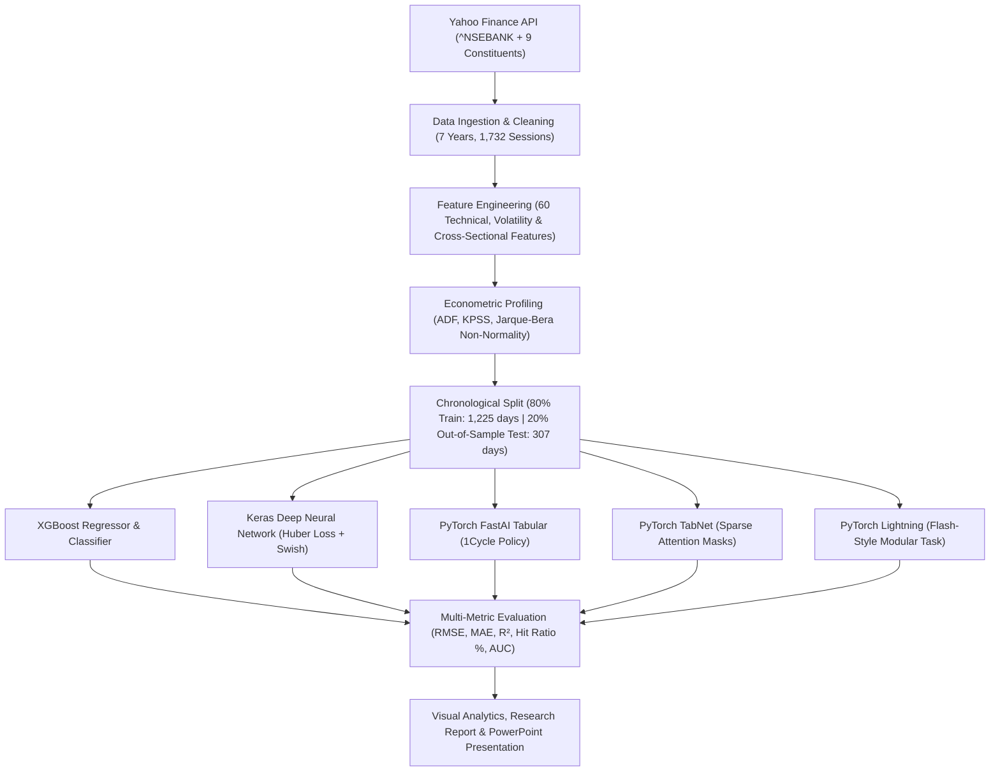

# Bank Nifty Performance Return Prediction

[](https://www.python.org/)
[](https://opensource.org/licenses/MIT)
[]()

An end-to-end quantitative financial machine learning project to predict the next-day returns and directional movement of India's benchmark **Nifty Bank Index (`^NSEBANK`)** across 5 distinct machine learning and deep learning paradigms:
1. **XGBoost**
2. **Keras (TensorFlow)**
3. **PyTorch with FastAI**
4. **PyTorch with TabNet**
5. **PyTorch Lightning (Flash-Style)**

---

## 📊 Benchmark Summary Results

Evaluated out-of-sample on **307 unseen trading sessions** (July 2025 to October 2026) using strict chronological splitting (no lookahead bias):

| Model | RMSE (%) | MAE (%) | $R^2$ Score | Directional Hit Ratio (%) | Pearson Corr ($r$) | Classification Accuracy (%) | ROC-AUC | Training Time (s) | Simplicity | Transparency | Efficacy |
| :--- | :---: | :---: | :---: | :---: | :---: | :---: | :---: | :---: | :--- | :--- | :--- |
| **XGBoost** | 1.0386 | 0.7405 | -0.0815 | 48.53% | 0.0211 | 46.25% | 0.4602 | **0.66s** | High | High | High |
| **Keras** | 1.0144 | 0.7110 | -0.0317 | **54.72%** | 0.0681 | 53.42% | 0.5372 | 7.82s | Moderate | Low | Moderate |
| **FastAI** | 1.0827 | 0.7987 | -0.1753 | 49.84% | 0.0950 | **54.72%** | 0.5608 | 5.49s | Moderate-High | Low-Moderate | Moderate |
| **TabNet** | 1.0141 | **0.7052** | -0.0310 | 45.60% | -0.0019 | 53.75% | **0.5675** | 23.19s | Moderate | High | Moderate-Low |
| **PyTorch Lightning** | **1.0129** | 0.7226 | **-0.0287** | **54.07%** | **0.1416** | 49.19% | 0.4852 | 4.42s | Complex | Low | High |

### 🔑 Key Takeaways
- **Directional Alpha**: **Keras** achieved **54.72%** and **PyTorch Lightning** achieved **54.07%** directional hit ratio, comfortably beating the 50% random coin-toss baseline.
- **Top Regression Accuracy**: **PyTorch Lightning** achieved the lowest RMSE (**1.0129%**) and highest correlation (**$r = 0.1416$**); **TabNet** achieved the lowest MAE (**0.7052%**).
- **Computational Speed**: **XGBoost** trained in just **0.66 seconds** (over 30x faster than TabNet).
- **Top Alpha Indicator**: Constituent market breadth (`bank_breadth_positive_ratio`) ranked as the #1 predictive feature across tree gain and attention masks.

---

## 🏗️ Architecture Pipeline



---

## 📁 Repository Structure

```
bank_nifty_return_prediction/
│
├── data/
│   ├── raw/
│   │   ├── bank_nifty_raw.csv                  # 7-year raw Bank Nifty index OHLCV
│   │   └── bank_nifty_constituents.csv         # 9 constituent bank stocks OHLCV
│   └── processed/
│       ├── bank_nifty_engineered.csv           # Full 60-feature dataset (1,532 rows)
│       ├── train.csv                           # 1,225 training sessions
│       └── test.csv                            # 307 out-of-sample test sessions
│
├── notebooks/
│   └── Bank_Nifty_Return_Prediction.ipynb      # End-to-end interactive Jupyter Notebook
│
├── src/
│   ├── data_loader.py                          # Automated Yahoo Finance ingestion
│   ├── feature_engineering.py                  # 60-feature quantitative signal pipeline
│   ├── eda.py                                  # Econometric tests & visualization generator
│   ├── models/
│   │   ├── xgboost_model.py                    # XGBoost implementation
│   │   ├── keras_model.py                      # Keras/TensorFlow deep neural net
│   │   ├── fastai_model.py                     # FastAI tabular learner
│   │   ├── tabnet_model.py                     # PyTorch TabNet with attention masks
│   │   └── lightning_model.py                  # PyTorch Lightning Flash-style pipeline
│   ├── evaluation.py                           # Benchmark metrics & chart plotting
│   ├── generate_notebook.py                    # Notebook generator script
│   └── generate_presentation.py                # PowerPoint presentation generator
│
├── outputs/
│   ├── figures/                                # 8 high-resolution 300 DPI figures
│   │   ├── 01_price_and_volume.png
│   │   ├── 02_returns_distribution.png
│   │   ├── 03_correlation_heatmap.png
│   │   ├── 04_volatility_clustering.png
│   │   ├── 05_technical_indicators.png
│   │   ├── 06_model_comparison_metrics.png
│   │   ├── 07_predicted_vs_actual.png
│   │   └── 08_feature_importance.png
│   ├── BANK_NIFTY_RESEARCH_REPORT.md           # Formal academic/technical research report
│   ├── Bank_Nifty_Presentation.pptx            # 12-slide executive presentation
│   ├── VIVA_PREPARATION_GUIDE.md               # 25+ viva defense questions & answers
│   ├── eda_statistical_summary.csv             # Statistical & stationarity metrics
│   ├── metrics_summary.csv                     # Quantitative benchmark table
│   └── qualitative_comparison.csv              # Simplicity/Transparency/Efficacy table
│
├── run_pipeline.py                             # Master runner script
├── requirements.txt                            # Python dependencies
└── README.md                                   # Comprehensive documentation
```

---

## 🚀 Getting Started & Reproduction

### 1. Clone or Open the Repository
```bash
git clone https://github.com/<your-username>/bank_nifty_return_prediction.git
cd bank_nifty_return_prediction
```

### 2. Install Dependencies
```bash
pip install -r requirements.txt
```

### 3. Run the Master Benchmark Pipeline
```bash
python run_pipeline.py
```
This single command trains and benchmarks all 5 models, logs test metrics, and exports all evaluation plots and summary CSVs.

### 4. Interactive Jupyter Notebook
```bash
jupyter notebook notebooks/Bank_Nifty_Return_Prediction.ipynb
```

---

## 🎓 Viva & Presentation Preparation

- **Presentation Slide Deck**: `outputs/Bank_Nifty_Presentation.pptx` (12 professional slides with embedded figures, tables, and architectural summaries).
- **Viva Defense Guide**: `outputs/VIVA_PREPARATION_GUIDE.md` (Contains 25+ detailed questions on Efficient Market Hypothesis, Stationarity, Jarque-Bera fat tails, Huber loss mathematical formulation, 1Cycle policy, TabNet attention masks, and options trading implementation).
- **Formal Research Report**: `outputs/BANK_NIFTY_RESEARCH_REPORT.md`.

---

## 📄 License
This project is open-source and available under the [MIT License](LICENSE).
